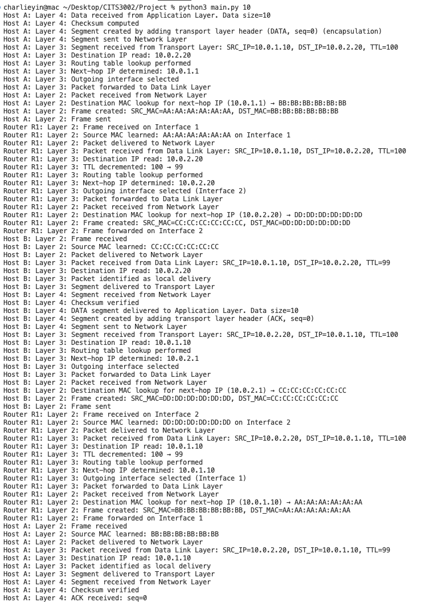

# Mini Internet Protocol Stack Simulator

A simplified **Mini Internet Protocol Stack Simulator** implemented in Python. This project demonstrates how **Layer 2 (Data Link)**, **Layer 3 (Network)**, and **Layer 4 (Transport)** work together to deliver application data from one host to another through a router.

## Table of Contents

- [1. Project Overview](#1-project-overview)
- [2. File Structure](#2-file-structure)
- [3. Protocol Design](#3-protocol-design)
- [4. Device Design](#4-device-design)
- [5. Execution](#5-execution)
- [6. Testing](#6-testing)
- [7. Limitations](#7-limitations)
- [8. Real-world Mapping](#8-real-world-mapping)

## 1. Project Overview

The simulated network topology consists of two hosts, **Host A** and **Host B**, connected through one router, **Router R1**. Host A is located in the `10.0.1.0/24` network, while Host B is located in the `10.0.2.0/24` network. Router R1 has two network interfaces, one connected to each subnet.

```text
           Host A (10.0.1.10)
                    |
          Network 1: 10.0.1.0/24
                    |
                Router R1
              IF1: 10.0.1.1
              IF2: 10.0.2.1
                    |
          Network 2: 10.0.2.0/24
                    |
           Host B (10.0.2.20)
```

The simulator implements three protocol layers:

- **Layer 2 — Ethernet-like Data Link Layer:** MAC addressing, frame creation, MAC lookup, and local frame delivery.
- **Layer 3 — IP-like Network Layer:** IP addressing, routing decisions, packet forwarding, and TTL handling.
- **Layer 4 — UDP-like Transport Layer with additional reliability features:** ACK support, checksum verification, sequence numbers, segmentation, and reliable data transfer based on the alternating-bit protocol.

## 2. File Structure

```text
.
├── main.py
├── config.py
├── protocol.py
├── devices.py
└── README.md
```

| File | Description |
| --- | --- |
| `main.py` | Main entry point. Creates the network topology, initializes Host A, Host B, and Router R1, and starts end-to-end transmission based on the command-line argument. |
| `config.py` | Stores fixed configuration parameters, including IP and MAC addresses, protocol constants, routing-related information, and MAC lookup tables. |
| `protocol.py` | Defines `Frame` (Layer 2), `Packet` (Layer 3), and `Segment` (Layer 4), and implements Layer 4 checksum calculation and verification. |
| `devices.py` | Implements `Host` and `Router`. Hosts handle segmentation, checksums, ACKs, encapsulation, and decapsulation. The router handles routing, TTL, MAC learning, and frame re-encapsulation. |
| `README.md` | Explains the project and how to run the simulator. |

## 3. Protocol Design

The simulator uses a simplified layered protocol stack. Each layer encapsulates the payload received from the layer above it into its own protocol structure.

### 3.1 Layer 2: Frame, MAC Addressing, Forwarding

Layer 2 provides local frame delivery between directly connected devices. The Ethernet-like frame contains:

- Source MAC address
- Destination MAC address
- EtherType
- Payload (a Layer 3 packet)

Hosts and the router use predefined MAC lookup tables stored in `config.py`. Before transmission, the sender resolves the next-hop MAC address and encapsulates the Layer 3 packet in a frame.

The router forwards a frame by:

1. Receiving the frame.
2. Extracting the Layer 3 packet.
3. Making a Layer 3 routing decision.
4. Creating a new Layer 2 frame for the next local link.

The MAC addresses change at each hop while the IP packet is preserved (apart from forwarding-related changes such as TTL).

### 3.2 Layer 3: Packet, IP Addressing, Routing, TTL

Layer 3 handles logical addressing and routing between networks. The simplified IP-like packet contains:

- Source IP address
- Destination IP address
- TTL
- Protocol field
- Total Length
- Payload (a Layer 4 segment)

Routing decisions are implemented in the `Router` class. The router examines the destination IP address and selects an outgoing interface according to the destination network:

| Network | Subnet |
| --- | --- |
| Network 1 | `10.0.1.0/24` |
| Network 2 | `10.0.2.0/24` |

The router decrements TTL when forwarding a packet. If TTL reaches zero, the packet is discarded to prevent indefinite forwarding loops.

A host delivers a packet to the Transport Layer only if its destination IP matches the host's local IP address.

### 3.3 Layer 4: Segment, Checksum, ACK, Sequence Number, Segmentation

Layer 4 handles end-to-end data delivery. The project uses a **UDP-like** transport protocol with additional reliability features.

The segment contains:

- Source Port
- Destination Port
- Length
- Checksum
- Type
- Sequence Number
- Data

> **Note:** `Type` and `Sequence Number` are project-specific additions and are **not** fields in the real UDP header.

The `Type` field identifies either a `DATA` or an `ACK` segment. Sequence numbers alternate between `0` and `1` to implement a simplified alternating-bit reliable transfer mechanism.

The sender computes a checksum when creating a segment, and the receiver verifies it on arrival to simulate transport-layer error detection.

When application data exceeds **500 bytes**, it is divided into multiple segments. Each segment is transmitted independently and acknowledged separately with an ACK segment. This illustrates core reliable-transport concepts without implementing full TCP.

## 4. Device Design

### 4.1 Host

The `Host` class models an end device with Layer 2, Layer 3, and Layer 4 functionality.

**Sending (encapsulation):**

1. Divide application data into segments if it exceeds 500 bytes.
2. Create a Layer 4 segment with source/destination ports, checksum, type, and sequence number.
3. Encapsulate the segment into a Layer 3 packet with source/destination IP addresses.
4. Encapsulate the packet into a Layer 2 frame with source/destination MAC addresses.
5. Send the frame to the router.

**Receiving (decapsulation):**

1. Receive the Layer 2 frame and extract its packet payload.
2. Check whether the destination IP matches the local host.
3. Extract the Layer 4 segment and verify its checksum.
4. Deliver `DATA` segments to the simulated Application Layer.
5. Process `ACK` segments to confirm successful transmission.

The host also supports checksum generation and verification, segmentation, acknowledgement generation, sequence-number handling, and MAC learning.

### 4.2 Router

The `Router` class simulates a Layer 2/Layer 3 forwarding device with two interfaces:

- **Interface 1:** Connected to Network 1.
- **Interface 2:** Connected to Network 2.

Each interface has an IP address, MAC address, and MAC lookup table.

When the router receives a frame, it:

1. Learns the source MAC address.
2. Extracts the Layer 3 packet.
3. Examines the destination IP address.
4. Selects the outgoing interface using its routing logic.
5. Decrements TTL.
6. Creates a new Layer 2 frame with the next link's source and destination MAC addresses.
7. Forwards the frame to the next host.

The router does **not** process application data or transport-layer ports. It performs Layer 3 forwarding and Layer 2 frame re-encapsulation, replacing the Ethernet frame at each hop while preserving the IP packet's payload.

## 5. Execution

Run the simulator through `main.py`, passing the application message size (in bytes) as a command-line argument.

**Example 1 — 10-byte message:**

```bash
python3 main.py 10
```

Host A sends one 10-byte `DATA` segment to Host B. Host B verifies the checksum, delivers the data to the Application Layer, and returns an `ACK` segment to Host A.

**Example 2 — 1200-byte message:**

```bash
python3 main.py 1200
```

The application message is divided into three Layer 4 segments:

| Segment | Data size | Sequence number |
| --- | ---: | ---: |
| 1 | 500 bytes | 0 |
| 2 | 500 bytes | 1 |
| 3 | 200 bytes | 0 |

Segments are sent sequentially. Host A waits for the correct ACK before sending the next segment.

## 6. Testing

### 6.1 Test Case 1: 10-byte DATA and ACK Transmission

```bash
python3 main.py 10
```

<!-- IMAGE PLACEHOLDER: Replace the path below after adding your screenshot to the repository. -->
<!-- Suggested path: images/test-10-bytes.png -->



*Figure 1: Successful 10-byte DATA and ACK transmission.*

The output confirms that:

- Layer 4 encapsulation was performed correctly.
- Layer 3 routing and TTL decrement occurred at Router R1.
- Layer 2 MAC addresses changed at each hop.
- Host B delivered the DATA segment to the Application Layer.
- Host A received the ACK returned by Host B.

### 6.2 Test Case 2: 1200-byte Application Message Segmentation

```bash
python3 main.py 1200
```

<!-- IMAGE PLACEHOLDER: Replace the path below after adding your screenshot to the repository. -->
<!-- Suggested path: images/test-1200-bytes.png -->


*Figure 2: Segmentation of a 1200-byte application message.*

With `MAX_SEGMENT_DATA = 500`, the original 1200-byte message is divided into:

- First segment: **500 bytes**, `seq=0`
- Second segment: **500 bytes**, `seq=1`
- Third segment: **200 bytes**, `seq=0`

The alternating sequence numbers (`0 → 1 → 0`) demonstrate the simplified alternating-bit reliable transmission mechanism.

The output also confirms that:

- A checksum was computed for every segment.
- A Layer 4 header was added during encapsulation.
- Each segment was forwarded to the Network Layer after creation.

These observations demonstrate segmentation, encapsulation, and preparation for reliable transmission before data passes to Layer 3.

## 7. Limitations

This project is a **logical protocol stack simulator**, not a real network implementation using operating-system sockets or physical interfaces. Devices exchange data through Python objects and method calls.

The simulator does **not** implement:

- Real socket-based communication
- Dynamic ARP request/reply mechanisms
- Real packet loss or retransmission timers
- Congestion control
- Flow control
- Real Ethernet CRC/FCS handling
- Actual parallel network transmission

The Layer 4 protocol is UDP-like with project-specific ACK and sequence-number fields; it is **neither a full UDP nor a full TCP implementation**.

Even with these simplifications, the simulator demonstrates encapsulation and decapsulation, MAC addressing, IP routing, TTL handling, segmentation, checksum verification, and acknowledgement-based end-to-end delivery.

## 8. Real-world Mapping

| Real router command / concept | Real meaning | Project equivalent |
| --- | --- | --- |
| `ip addr` | Displays interfaces, IP addresses, and MAC addresses | `self.interfaces` in `Router` |
| `arp -a` | Displays IP-to-MAC mappings | `MAC_TABLE_*` in `config.py` |
| `ip route` | Displays the routing table | `is_network_1()`, `is_network_2()`, and routing decisions in `receive_packet()` |
| Ethernet frame | Local Layer 2 delivery | `Frame` class (simplified header) |
| IP packet | Layer 3 routing | `Packet` class (simplified header) |
| UDP segment | Layer 4 transport | `Segment` class (UDP-like transport segment with ACK support) |
